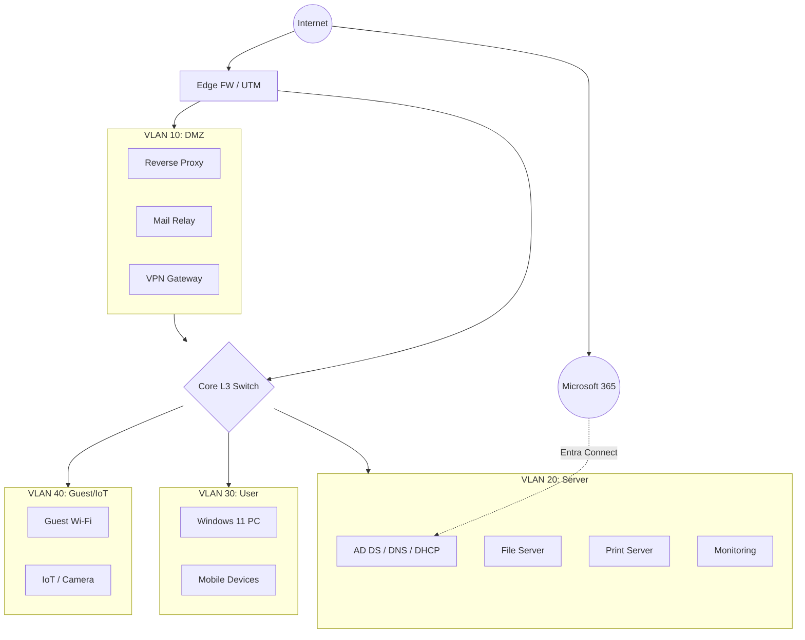

# サーバー構築の手順・補助設計

[構築内容へ戻る](https://ns7jp.github.io/infra-lab.html)

構築ページから分けた学習用の説明です。コード・設計・手順の存在と、本人が操作した結果は分けて扱います。文書とコードの作成にはAIを利用しています。

## 過去の記録と現在の状況

以下の数値と確認範囲は、各日付・環境・対象版で得た結果です。現在の実施状況は[検証証跡台帳](https://github.com/ns7jp/server/blob/main/docs/evidence/README.md)を参照してください。10月31日の2サービス再起動確認と、11月のKVM上の監視・ローカル通知等の本人実習は、8〜9月の記録とは別に採録されています。過去の未実施欄を、現在の状況に置き換えません。

| 日付 | 実行環境・区分 | 記録と確認範囲 |
| --- | --- | --- |
| 2026-08-17 | CI | [4種類の自動設定・再実行・確認（2分42秒）](https://github.com/ns7jp/server/blob/0d82d6865db8f5198bb16bc44b670b97ffb4726f/docs/evidence/2026-08-17-molecule.md) |
| 2026-08-18 | WSL2・Docker。記録の実行者欄は本人 | [監視9サービス、実データ表示、ログ103行](https://github.com/ns7jp/server/blob/0d82d6865db8f5198bb16bc44b670b97ffb4726f/docs/evidence/2026-08-18-local-observability.md) |
| 2026-08-19 | WSL2・Docker。実行者未記載 | [D-1の復旧13秒](https://github.com/ns7jp/server/blob/0d82d6865db8f5198bb16bc44b670b97ffb4726f/docs/drills/logs/2026-08-19-D-1.md)。本人操作の実績には加えません |
| 2026-08-22 | CI・Docker導入済み一時Ubuntu | [構築から復旧までの23項目合格](https://github.com/ns7jp/server/blob/4a292026b569dd1a522c0f2913b4ad40aeccebe7/docs/evidence/2026-08-22-full-stack-e2e.md)。監視10＋通知確認1サービス、Dockerの読取り成功・書込み拒否・ログ到達を含む |
| 2026-08-23 | CI・一時環境 | [指定した前の版への切り戻し](https://github.com/ns7jp/server/actions/runs/32611251044)。継続利用する独立サーバーでの受入試験ではありません |

D-1の実行者区分は[主作品の記載](https://github.com/ns7jp/server/blob/main/docs/project-reference.md)に従っています。8月18日・19日の画面とログを再構成した[動画](https://ns7jp.github.io/demo.html)は、連続した操作録画ではありません。

### 本人が操作した基盤構築

- 9月4日：AIの案内を受け、Hyper-V上のUbuntuへAnsibleの基本設定とDockerを適用。AlmaLinuxは再利用VMへの適用で、新規構築・最小公開の証明には含めません。[Ubuntu](https://github.com/ns7jp/server/blob/main/docs/evidence/2026-09-04-ansible-foundation-build.md)／[AlmaLinux](https://github.com/ns7jp/server/blob/main/docs/evidence/2026-09-04-ansible-foundation-el9-build.md)
- 9月7〜8日：Ubuntu Server 24.04を手作業で初期構築。固定IP、SSH鍵認証、UFW、時刻同期、自動更新と、意図的な設定不備からの復旧を確認。OS再起動後の基盤設定も記録しています。[初期構築](https://github.com/ns7jp/server/blob/main/docs/evidence/2026-09-08-lab-base01-initial-build.md)
- Docker未導入Ubuntuへの導入は、9月4日のAnsibleと、9月8日・10月1日の手作業に記録があります。9月8日は[Docker公式のUbuntu向け配布元](https://docs.docker.com/engine/install/ubuntu/)を使用しました。

上記はAIの手順案内を受けた本人操作です。監視一式の長期稼働、別サーバー復元、本番運用や独力再現を証明するものではありません。

## 手を動かす前に

UbuntuまたはRHEL系の練習用VMを用意します。WSL2でも一部を試せますが、各手順の実施条件を確認してください。[環境準備](environment-setup.md)／[8段階の学習ルート](https://ns7jp.github.io/learning-path.html)

- **changed=0**：Ansibleの再実行で変更が報告されなかった状態。確認した条件での結果であり、あらゆる再実行の安全を保証しません。
- **D-1 / D-2**：D-1はアプリのプロセス停止と自動復旧、D-2は別サーバーへの復元を扱う演習です。D-2の実施状況は台帳で確認します。
- **NOT SET / NOT RUN / NOT READY**：値が未確定／未実行／完了条件が未充足、という状態を区別します。

## 構築手順書の要点

- **作業前確認：**作業を始める前に、条件を先に決めて固定します。決めるのは、対象VM（作業する仮想マシン）、sudo（管理者の権限で命令を実行する仕組み）が使えるかどうか、対象IP、作業時間、ロールバック条件（元に戻すと判断する基準）、対象commit SHA（変更履歴の1点を指す番号）です。作業中に迷わず、後から同じ状態を再現できるようにするためです。
- **準備〜構築：**まず、作業する側のパソコン（管理端末）にAnsibleを用意します。次に、inventory（作業対象のサーバー一覧）と、パスワードなどの秘密値（vault）を設定します。そのうえで`--check --diff`を付けて実行し、実際には変更せずに何が変わるかだけを先に確認します（プレフライト確認）。問題がなければ本番どおりに実行します。
- **冪等性確認：**同じplaybook（Ansibleの作業手順書ファイル）をもう一度実行し、`failed=0`かつ`changed=0`であることを記録します。これは確認した条件での再実行結果であり、すべての条件での安全性を保証するものではありません。
- **構築後確認・障害試験：**まず、サービスが動いているか、ポート待受（外からの通信を受け付けている状態）になっているかを確認します。そのうえでD-1（プロセス停止）演習を行い、異常に気づくまでの時間と復旧までの時間を記録します。止まったときに何秒で戻せるかを数字で言えるようにするためです。
- **ロールバック・作業終了：**問題があれば、変更前のcommit（変更履歴の1点）まで戻します。これがロールバック（元の状態へ戻すこと）です。最後に結果票とログを保存し、作業結果報告書へ写して作業を終えます。

[詳細な構築手順](https://github.com/ns7jp/server/blob/main/docs/build-package/05-build-procedure.md)／[12種類の構築資料](https://ns7jp.github.io/infra-lab.html#deliverables-title)

## 工程ごとの記録の読み方

設計書・設定コード・試験手順・引き渡し用紙は、作成した資料として示します。構築・監視・復旧の実測は、上の表と原記録で日付・環境・実行者を確認します。実案件欄が未確定の報告書や未実施の受入手順は、実務実績として扱いません。

## 補助成果：ITサポートを想定した設計例（Windows / M365 / AD）

**補助学習：**Windows、Microsoft 365、Active Directoryの問い合わせ対応を想定した設計例です。実際の組織の環境を構築・運用した実績ではありません。Linuxサーバーを中心とする主作品とは分けて掲載しています。

ADの本人実習は[トップページ](https://ns7jp.github.io/index.html#three-records)と[原記録](https://github.com/ns7jp/server/blob/main/docs/evidence/2026-09-01-ad-build-validation.md)で案内しています。9月のSystem State復元は翌日にSYSVOL欠損が判明し、修正手順の実機検証は未完了です。この設計例をAD実習の完了証拠として扱いません。

**かんたんに言うと**下の図は、会社の中のネットワークを用途ごとに部屋分けした設計例です。VLANはその「部屋」にあたる区切りで、外部に見せるサーバー、社内サーバー、社員のパソコン、来客用Wi-Fiを別々にしています。分けておくと、1か所で問題が起きても他へ広がりにくくなります。

### 想定運用シナリオ

- 問い合わせ受付後、端末・ネットワーク・アカウント・ライセンスを順に確認する。
- 確認した結果は、問い合わせ記録（チケット）へ添付しやすいJSON・CSV・HTMLの形式で残す。
- 利用者影響、再現性、変更履歴、セキュリティ影響を見てエスカレーションを判断する。
- 対応後は再発防止メモとナレッジ更新候補を残す。

### セグメント設計の考え方

- **DMZ VLAN 10**: 外部へ公開するサービスだけを置く区画。ここから社内側のVLANへ戻る通信は、ACL（通信を許可・拒否する条件の一覧）で明示的に許可したものだけ通す。
- **Server VLAN 20**: AD/DNS/DHCP/ファイル/監視。クライアントVLANから必要ポートのみ許可。
- **User VLAN 30**: 業務端末。サーバーVLANへは必要ポートのみ、Guest VLANは完全分離。
- **Guest / IoT VLAN 40**: インターネット出口のみ許可。社内資産には到達不可。
- **Microsoft 365**: クラウド側の利用者管理であるEntra IDと、同期の仕組みであるEntra Connectを使い、社内に置いたAD（Active Directory）とアカウント情報をそろえる。条件付きアクセスの設定で、会社の基準を満たした端末以外は接続させない。

## 確認項目と記録

| 対象 | 確認観点 | 使用スクリプト・確認記録 | 最初の対応 / 引き継ぎ基準 |
| --- | --- | --- | --- |
| 端末ヘルス | OS、空き容量、更新、Defender、Firewall、BitLocker | [Collect-PcInventory.ps1](../support-scripts/Collect-PcInventory.ps1) [Test-SecurityBaseline.ps1](../support-scripts/Test-SecurityBaseline.ps1) | 警告項目をチケットへ添付し、設定変更が必要な場合は管理者へ引き継ぐ。 |
| ネットワーク | 本人のみか全体か、IP、DNS、ゲートウェイ、外部到達性 | [Test-NetworkTriage.ps1](../support-scripts/Test-NetworkTriage.ps1) [network-triage.sample.csv](../support-scripts/samples/network-triage.sample.csv) | 複数端末で不可ならネットワーク機器・回線側として上位担当へ連携する。 |
| 性能・ログ | CPU、メモリ、ディスク、直近エラー、発生時刻 | [Test-DiskCapacity.ps1](../support-scripts/Test-DiskCapacity.ps1) [Get-RecentSupportEvents.ps1](../support-scripts/Get-RecentSupportEvents.ps1) | ディスク90%以上、同一エラー反復、業務停止がある場合は影響範囲を添えて引き継ぐ。 |
| AD / M365 | 休眠アカウント、所属グループ、ライセンス割当、利用率 | [Get-StaleUserAccounts.ps1](../support-scripts/Get-StaleUserAccounts.ps1) [Get-M365LicenseInventory.ps1](../support-scripts/Get-M365LicenseInventory.ps1) | 権限変更・停止・ライセンス回収は申請情報と承認の有無を確認してから実施担当へ渡す。 |

## 問い合わせ対応の流れ

### 受付

現象、発生時刻、対象者、業務影響、再現条件を確認。

### 原因の場所を絞る

端末、ネットワーク、アカウント、サービス側のどこに原因があるかを、順番に切り分けます。

### 結果を保存

確認コマンド、ログ、スクリーンショット、出力ファイルを添付。

### 対応・連携

自分の担当範囲で解決しない場合は、影響した範囲と考えられる原因を添えて引き継ぎ。

### 再発防止

同じ問い合わせを繰り返さないために、手順書の更新、よくある質問（FAQ）への追加、監視項目の追加、定期点検の対象にすることを検討します。

### 公開済みの出力サンプル

実行後に何が残るかを確認しやすいよう、架空端末・架空ユーザーのサンプル出力を用意しています。

- [JSONを見る](../support-scripts/samples/pc-inventory.sample.json)
- [CSVを見る](../support-scripts/samples/network-triage.sample.csv)
- [HTMLレポートを見る](https://ns7jp.github.io/support-scripts/samples/endpoint-daily-report.sample.html)

### 関連する学習内容

最初に見ていただきたいのはLinuxサーバーの構築手順と確認資料です。Windows、Microsoft 365、Active Directory、クラウド、問い合わせ対応の資料は補助学習として掲載しています。

以下は関連資料へのリンクです。英字の名前が並びますが、SLOはサービスの品質目標、Error Budgetは許される失敗の量、Runbookは手順書、Postmortemは障害の振り返り記録、Production Readinessは本番で使ってよいかの点検表を指します。

- [Linux Lab](https://ns7jp.github.io/linux-lab.html)
- [Cloud Lab](https://ns7jp.github.io/cloud-lab.html)
- [Monitoring Stack（初期作品・アーカイブ）](../monitoring-stack/)
- [Ansible Playbook](../ansible/)
- [CIS自己マッピング](https://github.com/ns7jp/ns7jp.github.io/blob/main/ansible/cis-benchmark-mapping.md)
- [Infra出力サンプル](../infra-evidence/)
- [Production Readiness](https://github.com/ns7jp/ns7jp.github.io/blob/main/production-readiness.md)
- [SLO / Error Budget](https://github.com/ns7jp/ns7jp.github.io/blob/main/support-docs/slo-error-budget.md)
- [チケット分類 (ITIL)](https://github.com/ns7jp/ns7jp.github.io/blob/main/support-docs/ticket-taxonomy.md)
- [物理層](https://github.com/ns7jp/ns7jp.github.io/blob/main/support-docs/office-it-physical-layer.md)
- [M365 ポリシー JSON](../support-docs/m365-policy-examples/)
- [AD/M365 変更ケース](https://github.com/ns7jp/ns7jp.github.io/blob/main/support-docs/ad-m365-change-case.md)
- [架空Postmortemサンプル](https://github.com/ns7jp/ns7jp.github.io/blob/main/support-docs/postmortem-example.md)
- [Backup / DR計画](https://github.com/ns7jp/ns7jp.github.io/blob/main/support-docs/backup-restore-runbook.md)
- [Failover Runbook](https://github.com/ns7jp/ns7jp.github.io/blob/main/support-docs/failover-runbook.md)
- [Network切り分け想定例](https://github.com/ns7jp/ns7jp.github.io/blob/main/support-docs/network-triage-evidence.md)
