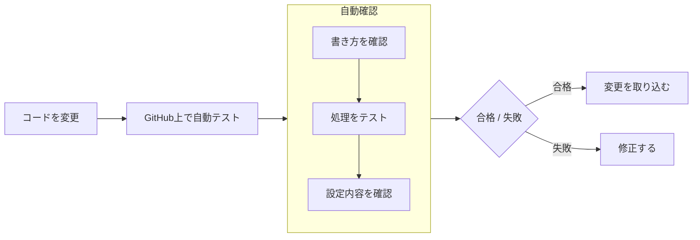
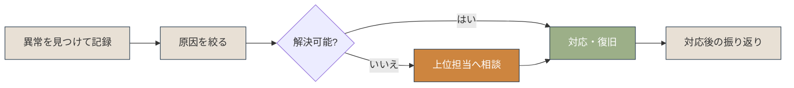

# 作品の機能・制作メモ

[作品一覧へ戻る](https://ns7jp.github.io/works.html)

作品一覧から分けた機能説明・コード例・制作時のメモです。個人学習と訓練の成果物であり、顧客環境での運用実績ではありません。文章・コード・テストの作成にはAIを利用しています。記載された修正や実行結果は、本人の独力再現・説明を確認したものではありません。

主作品の過去の実測は記録時点の環境・版に限定します。本人操作、CI、AI側での実行を分けた最新の状況は、[検証証跡台帳](https://github.com/ns7jp/server/blob/main/docs/evidence/README.md)を参照してください。以下のコードは説明用の抜粋で、現行実装の正本ではありません。

<a id="work-server-monitor"></a>

## Server Monitor — Linuxサーバー設計・構築・運用

以下の実測説明は主に2026年8〜9月の記録です。2026年11月の本人実習など、その後の追加記録は上記台帳を参照してください。

「設計 → 構築 → 試験 → 監視 → 復旧 → 引き渡し」の順で学習内容を整理しました。2026年8月22日に、テストのたびに作り直す一時Ubuntu環境で23項目を確認しました。翌日は前の版へ戻す自動テストにも合格しました。その日ごとの記録は、当時の記録としてそのまま残しています。いま何をどこまで確認できているかは、[現行mainの証跡台帳](https://github.com/ns7jp/server/blob/main/docs/evidence/README.md)（最新版に付けた確認記録の一覧）を、正式な版として扱います。

- **構成図：**サーバーやネットワーク機器をどのようにつなぐか、図で整理しました。
- **設定の自動化：**Ansible（サーバーの設定を自動で行う道具）を使い、同じ手順を何度でも繰り返せるようにしました。手作業による入力ミスと作業時間を減らすためです。
- **監視とログ：**Prometheus（数値を集める道具）、Grafana（集めた数値を画面に描く道具）、Loki（動作の記録を集めて検索する道具）を使いました。サーバーの数値と記録（ログ）を、一か所で確認できます。
- **バックアップと復旧：**復旧までの時間（RTO）と、失ってよいデータ範囲（RPO）を考え、同じ環境への復元を練習しました。
- **自動テスト：**GitHub Actions（GitHubが用意した自動実行のしくみ）を使います。設定ファイルやスクリプトを変更するたびに、誤りがないかを機械が自動で確認します。

### 学習した作業の例（2026年8〜9月の記録）

- **状態確認：**サービス、ログ、CPU、メモリ、ディスク、通信状況を同じ順番で確認し、結果を残す。
- **新規設定：**Ansibleの設定を一度まとめて適用し、2回目に不要な変更が出ないことを確認する。同じ条件で設定を再適用した結果を確かめるため。監視まで含めた設定全体（`site.yml`）を、Dockerを入れていない最小構成のOSへ適用するのは未実施です（基本設定とDockerだけの`foundation.yml`は、2026年9月4日に手元の仮想マシンで適用し、2回目の変更0件を確認）。
- **稼働確認：**11個のサービスを起動し、監視通知、アクセス制限、ログの保存を確認する。11個そろえての確認はGitHubの自動テストの一時環境だけです。手元の仮想マシンでは、本人が5〜6個のサービスに分けて確かめました（通知の確認はしていません）。Slackへの実通知は未実施です。
- **障害復旧：**停止させたサービスの自動復旧と、バックアップからの復元を確認する。別サーバーへの復元は未実施です。
- **作業後の記録：**起きたこと、影響、原因、対応、残った課題を分けて記録する。

### 変更時の自動テスト（CI／変更のたびに機械がまとめて確認するしくみ）



設定変更による問題を早めに見つけるため、サーバー設定と運用スクリプトをGitHub上で自動確認しています。

### 制作中に困ったことと解決

**課題：**Windows向けのPowerShellスクリプトを、GitHub上のLinux環境でもテストできるか分かりませんでした。

**対応：**OSに依存しない判定処理を別ファイルへ分け、PowerShellのテストツール（Pester）で確認できる形にしました。

関連リンク：[リポジトリ](https://github.com/ns7jp/server) ／ [6工程](https://ns7jp.github.io/project-brief.html) ／ [動作確認記録](https://ns7jp.github.io/evidence-demo.html) ／ [構築内容](https://ns7jp.github.io/infra-lab.html) ／ [現行証跡台帳](https://github.com/ns7jp/server/blob/main/docs/evidence/README.md)

<a id="work-support-toolkit"></a>

## 運用サポート資料集

想定手順・架空ケース・サンプル出力をまとめた教材です。会社の実環境で使った記録ではありません。

想定した環境は、Windows 11、Microsoft 365（メールやファイル共有などをまとめて使えるサービス）、Active Directory（社内アカウント管理）です。この環境で、PC初期設定、退職者アカウント停止、共有フォルダの権限確認、ネットワークの一次確認などをまとめています。公開内容は想定手順、架空のケース、サンプル出力であり、実務での作業記録ではありません。

- 問い合わせを受けた後に「何を、どの順番で確認し、何を記録するか」を整理しました。
- 確認結果をファイルに出力し、作業記録や引き継ぎ資料へ添付しやすくしました。
- 公開ポートフォリオとして、社内固有情報や認証情報を含めない安全なサンプルにしています。

### 問題を受け付けてから振り返るまで



この資料集は、問題の発見・記録と、最初の原因調査を進めるための確認ツールや振り返り用の書式をまとめたものです。

### 確認ツールの工夫

**かんたんに言うと**下のコードは、CPUとメモリの使用率を受け取り、Healthy（正常）、Warning（注意）、Critical（危険）のどれかを返すだけの短い部品です。

PowerShellの確認ツールは、状態を判定する部分だけを別に分けました。こうすると同じ処理を他でも使い回せて、自動テストもしやすくなります。

```powershell
function Get-ResourceStatus {
    [CmdletBinding()]
    param (
        [Parameter(Mandatory=$true)][int]$CpuPercent,
        [Parameter(Mandatory=$true)][int]$MemoryPercent
    )

    $status = "Healthy"
    if ($CpuPercent -ge 90 -or $MemoryPercent -ge 90) {
        $status = "Critical"
    } elseif ($CpuPercent -ge 75 -or $MemoryPercent -ge 75) {
        $status = "Warning"
    }

    return [PSCustomObject]@{
        Timestamp = (Get-Date).ToString("yyyy-MM-dd HH:mm:ss")
        Status    = $status
        CPU       = $CpuPercent
        Memory    = $MemoryPercent
    }
}
```

### 制作中に困ったことと解決

**課題：**実務に近づけようとすると、社内固有のサーバー名・ユーザーID・権限情報のような公開に不向きな情報が混ざりやすい。

**対応：**架空のWindows 11、Microsoft 365、Active Directory環境に統一し、確認ツールも読み取り中心の安全な内容にしました。注意事項はREADMEにも記載しています。

関連リンク：[手順書](https://github.com/ns7jp/ns7jp.github.io/tree/main/support-docs) ／ [確認ツール](https://github.com/ns7jp/ns7jp.github.io/tree/main/support-scripts) ／ [出力例](https://github.com/ns7jp/ns7jp.github.io/tree/main/support-scripts/samples)

<a id="work-monitor"></a>

## サーバー監視ダッシュボード

Server Monitor全体とは別作品として数えず、その中のPython製監視アプリを詳しく紹介する項目です。

Pythonで作った監視画面です。CPU、メモリ、ディスク、ネットワーク、動作中のプログラムを一画面で確認できます。負荷が高くなると色が緑から黄、橙、赤へ変わります。

同じ作品では、Ansibleによる設定の自動化、Dockerによる起動、PrometheusとGrafanaによる監視、Lokiによるログ保存も学習しました。AWS向けの設定コードは書き方の検査までで、実際のAWS環境は作成していません。全体は[制作概要](https://ns7jp.github.io/project-brief.html)と[サーバー構築の内容](https://ns7jp.github.io/infra-lab.html)で確認できます。

- 画面を再読み込みしなくても、数秒ごとに新しい情報を取得できるようにしました。
- psutilというPythonのライブラリ（よく使う処理をまとめた部品集）を使い、Windows、Linux、macOSの状態を同じ方法で取得します。
- Chart.jsを使い、CPUとメモリの直近60秒の変化をグラフにしました。

### サーバーの状態を画面へ渡す処理

Flask（PythonでWebの機能を作る道具）が、JSON形式（項目名と値を並べた、機械が読みやすいデータの書き方）で状態を返します。画面はそのままで、数値だけが新しくなります。

```python
@app.route('/api/stats')
def api_stats():
    # CPU使用率 (interval=0で即時取得できるための工夫を内部で実施)
    cpu_percent = psutil.cpu_percent(interval=0)
    cpu_cores = psutil.cpu_percent(interval=0, percpu=True)

    # メモリ情報
    mem = psutil.virtual_memory()

    # ディスク情報
    disk = psutil.disk_usage('/')

    return jsonify({
        'cpu': cpu_percent,
        'cpu_cores': cpu_cores,
        'memory': mem.percent,
        'disk': disk.percent,
        'timestamp': datetime.now().strftime('%H:%M:%S')
    })
```

### 制作中に困ったことと解決

**課題：**`psutil.cpu_percent()` を `interval=0` で呼ぶと、前回呼び出したときからの差を返します。そのため最初の1回は必ず0%になり、グラフの形が崩れて表示されました。

**対応：**全体使用率の取得時のみ `interval=0.5` で0.5秒ぶんの値を取り、基準点を作ります。その直後に、コアごとの値を `interval=0` で取得します。この変更内容を制作メモとして残しています。現在の動作と計測条件は、リンク先の実装・証跡で確認してください。

関連リンク：[コード](https://github.com/ns7jp/server)

<a id="work-teikei"></a>

## 定型文管理アプリ

Flet（Pythonだけで画面を作れる道具）を使い、パソコンで動く画面付きアプリを作りました。定型文の新規作成・編集・保存・削除ができます。これはCRUD（作成・読み取り・更新・削除という4つの基本操作）と呼ばれます。ボタン1回で文章をコピーでき、そのまま貼り付けられます。データはJSONファイルに保存するので、アプリを閉じても消えません。

- Fletを使い、PythonだけでGUIアプリを作れることを学びました。
- 定型文の保存・編集・削除という基本的なCRUD操作を実装しました。

### 制作中に困ったことと解決

**課題：**JSON保存時に日本語が `\uXXXX` 形式でエスケープされ、ファイルを直接開いても内容を確認できない。

**対応：**`json.dump(..., ensure_ascii=False, indent=2)` を指定し、日本語のまま整形保存。トラブル時のデータ確認が容易になった。

関連リンク：[コード](https://github.com/ns7jp/works/blob/main/teikei_kanri.py)

<a id="work-notes"></a>

## 付箋アプリ

Pythonのtkinterで作ったデスクトップ付箋アプリです。複数の付箋を自由に配置・作成・削除でき、内容はJSONファイルに自動保存されます。再起動後も付箋が復元されます。

- tkinterでGUI部品の配置とイベント処理を学習しました。
- 日常的に使えるツールとして、操作のわかりやすさを重視しました。

### 制作中に困ったことと解決

**課題：**付箋を移動して配置を変えても、再起動すると毎回初期位置に戻ってしまう。

**対応：**ウィンドウ終了時のイベントで `geometry()` を取得しJSONに保存、起動時に読み込んで位置を復元する処理に変更。

関連リンク：[コード](https://github.com/ns7jp/works/blob/main/sticky_notes.py)

<a id="work-pulse"></a>

## SNSアプリ「Pulse」

**公開状況：コードと保存済み画面を公開しています。ライブ動作は未確認です。**

「いいね」ではなく「共鳴」で繋がる、感情ムード投稿型のSNSアプリです。投稿時に8種のムードを選ぶと、カードの色がムードに対応して変化します。ささやきモード（匿名投稿）・タイムカプセル（未来日時公開）・感情天気予報（24時間分布）・感情オーラ（7日間傾向）など独自機能を実装しました。

- CSRF（利用者になりすまして勝手に送信させる攻撃）、XSS（他人が見るページに悪い命令を埋め込む攻撃）、SQLインジェクション（入力欄からデータベースを不正に操作する攻撃）への対策を入れました。パスワードはbcrypt（元に戻せない形へ変換する方式）で保存しています。
- SQLite（1つのファイルで動く小さなデータベース）を、PDO（PHPからデータベースを扱う共通の窓口）を通して操作しました。データベースのファイルは自動で作られます。そのため、使う人が事前に準備をしなくても動きます。

### 制作中に困ったことと解決

**課題：**開発環境と本番サーバーでSQLiteファイルの初期化挙動が異なり、デプロイ直後に「DBが存在しない」エラーが発生。

**対応：**起動時にDBファイルの有無を確認し、無ければスキーマを自動生成する処理を追加。環境ごとの手動セットアップが不要となった。

関連リンク：[コード](https://github.com/ns7jp/works/blob/pulse/index.php) ／ [保存済み画面](https://ns7jp.github.io/image/pulse.png)

<a id="work-post"></a>

## 掲示板アプリ

**公開状況：コードと保存済み画面を公開しています。ライブ動作は未確認です。**

PHPとMySQLを使った掲示板アプリです。ユーザー登録・ログイン・投稿・返信の基本機能を実装しました。不正な入力への対策も入れました。SQLインジェクション対策としてPDOのプリペアドステートメントを、XSS対策として表示時のhtmlspecialcharsによるエスケープを使用しました。これらは制作時の説明であり、今回コードを実行して確認した結果ではありません。

- ログイン・投稿・返信などWebアプリに必要な基本機能を一通り実装しました。
- PDO・セッション管理・入力値サニタイズなど、バックエンドのセキュリティ基礎を学びました。

### 制作中に困ったことと解決

**課題：**DB認証情報を db.php に直接記述しており、GitHub公開時に漏洩リスクがあることが判明。

**対応：**db.php は .gitignore（公開しないファイルを指定する設定）に書いて、公開の対象から外しました。かわりに、値を仮の文字に置き換えた db.example.php を用意しました。READMEに準備の手順を書き、他の人が自分のパソコンで安全に動かせるようにしました。

関連リンク：[コード](https://github.com/ns7jp/works/blob/post/index.php) ／ [保存済み画面](https://ns7jp.github.io/image/post.png)

<a id="work-magic"></a>

## サンプル企業サイト

**公開状況：コードと保存済み画面を公開しています。ライブ動作は未確認です。**

訓練校から渡されたデザインカンプ（完成イメージの見本）のPDFを見ながら、架空企業「MagicMoon」の会社紹介サイトを作りました。画面には4つの動きを付けました。三本線のメニュー、なめらかに移動するスクロール、背景がずれて動く演出（パララックス）、ふわりと現れる演出です。これらはVanilla JS（道具を足さない、素のJavaScript）だけで書き、jQueryという道具は使っていません。事例ページではLightbox2によるギャラリーも実装しています。

- Flexbox・CSS Gridによるレスポンシブレイアウトと、モバイルファーストのCSS設計を学びました。
- jQuery不使用でVanilla JSによるDOM操作・IntersectionObserverを活用しました。

### 制作中に困ったことと解決

**課題：**モバイルでハンバーガーメニューを開いたまま画面幅を変えると、メニューが閉じずレイアウトが崩れる。

**対応：**`resize` イベントを監視し、PC幅に戻った時点でメニュー状態をリセットする処理を追加。複数ブレイクポイントで動作確認を実施。

関連リンク：[コード](https://github.com/ns7jp/works/blob/magic/index.html) ／ [保存済み画面](https://ns7jp.github.io/image/magic.png)
